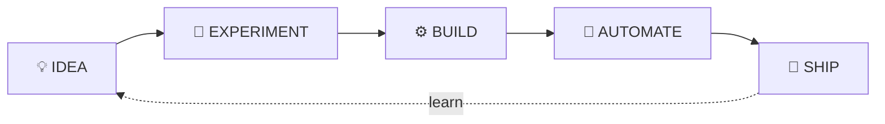

<div align="center">

# ◈ ABHIJITH // SANDBOX

### `BUILDING · EXPERIMENTING · BREAKING · LEARNING`

<br/>

> **A sandbox for engineering ideas at the edge of software, automation & AI.**

<br/>

[](https://github.com/abhijith-sandbox-gh)


</div>

---

## `> whoami`

```text
SYSTEM    : abhijith-sandbox-gh
TYPE      : Engineering Sandbox
MISSION   : Explore → Prototype → Automate → Ship
STATUS    : ONLINE
```

Welcome to **Abhijith Sandbox**.

This organization is my experimental engineering space for exploring new technologies, building prototypes, testing integrations, and turning interesting ideas into working software.

Not everything here is production-ready. **That's the point.**

---

## ⚡ `CURRENT_FOCUS`



- 🤖 **AI-assisted engineering**
- ⚙️ **Developer automation**
- 🔌 **APIs & integrations**
- 🧠 **Intelligent agents**
- 🛠️ **Developer tooling**
- ☁️ **Cloud-native experiments**
- 🔐 **GitHub automation**
- 🧪 **Proofs of concept**

---

## `> tech --stack`

<div align="center">


</div>

---

## 🛰️ `LAB_DIRECTORY`

```text
abhijith-sandbox-gh/
│
├── agents/          → AI & autonomous agent experiments
├── automation/      → workflows and developer productivity
├── integrations/    → APIs, connectors and platform experiments
├── prototypes/      → ideas turned into working code
├── playground/      → experiments with zero guarantees
└── .github/         → organization infrastructure
```

> Repositories will appear here as experiments come online.

---

## 🧬 `ENGINEERING_PROTOCOL`

```yaml
principles:
  - build_to_learn
  - automate_repetition
  - keep_experiments_small
  - document_the_weird_parts
  - prefer_working_software
  - iterate_without_fear

sandbox_mode: true
production_guarantees: false
curiosity: unlimited
```

---

## 📡 `SYSTEM_STATUS`

| MODULE | STATUS |
| :--- | :---: |
| Experiments | 🟢 ACTIVE |
| Automation | 🟢 ACTIVE |
| AI / Agents | 🟣 EXPLORING |
| Integrations | 🔵 BUILDING |
| Questionable Ideas | 🟢 ALWAYS |

---

<div align="center">

### `// EXPERIMENT. LEARN. ITERATE. SHIP.`

<br/>


<br/>

**[ ENTER THE SANDBOX ](https://github.com/abhijith-sandbox-gh)**

<sub>Built with ☕, curiosity, and occasionally questionable engineering
